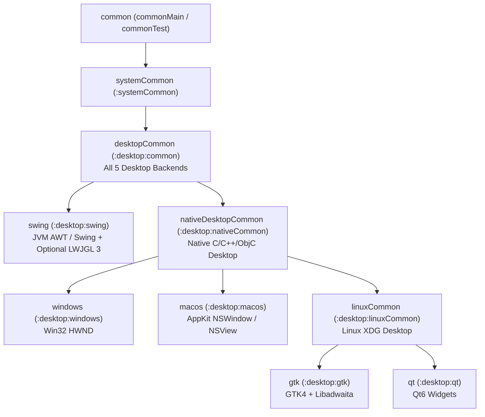

# GenericUI — Desktop Submodule (`:desktop`)

> **Root Repository**: [**GenericUI (`../README.md`)**](../README.md) | **Root Documentation**: [SourceSet Hierarchy](../docs/sourcesets.md) · [Backends Guide](../docs/backends.md) · [Fragments & Windows](../docs/fragments-and-windows.md) · [Application & Targets](../docs/application.md) · [Resources](../docs/resources.md) · [Extensions Guide](../docs/extensions.md) · [Gradle Plugin](../docs/gradle-plugin.md) · [UI Testing](../docs/testing.md)

The **Desktop Submodule (`:desktop`)** of **GenericUI** (`com.nexustools.genericui`) provides the hierarchical desktop common modules (`:desktop:common`, `:desktop:nativeCommon`, and `:desktop:linuxCommon`), four zero-overhead native OS desktop backends (`:desktop:windows`, `:desktop:macos`, `:desktop:gtk`, and `:desktop:qt`), and the Java/JVM desktop backend (`:desktop:swing`).

> [!IMPORTANT]
> **Strict Extension Isolation — Zero VLC or Media Code in `:desktop`**
> The `:desktop` submodule and all of its child modules (`:desktop:common`, `:desktop:nativeCommon`, `:desktop:linuxCommon`, `:desktop:windows`, `:desktop:macos`, `:desktop:gtk`, `:desktop:qt`, `:desktop:swing`) contain **NO** VLC (`libvlc` / `libvlcj`) or media playback code whatsoever. All video decoding, hardware acceleration (`D3D11VA`, `DXVA2`, `NVDEC`, `VAAPI`, `VDPAU`, `VideoToolbox`), Vulkan (`#version 450` SPIR-V) & OpenGL ES (`#version 300 es`) HDR tone-mapping, and audio spectrum analysis live strictly inside the **`:extensions:media`** extension ([`../extensions/docs/media.md`](../extensions/docs/media.md)).

---

## Phase 3 Desktop Module Hierarchy

Every module in `:desktop` is either a **common target module** or a **concrete backend target module**:

| Gradle Module | Directory | Target Platforms | Variant Scope / SourceSet | Responsibility & Native Backing | Detailed Guide |
| :--- | :--- | :--- | :--- | :--- | :--- |
| **`:desktop:common`** | [`common/`](./common/README.md) | `mingwX64`, `macosX64`, `macosArm64`, `linuxX64`, `linuxArm64`, `jvm` | `desktopCommon` (`AppTarget.DESKTOP_COMMON`) | Pure-Kotlin desktop runtime across all 5 desktop backends (including Swing): `DesktopLazyViewportEngine`, `DesktopFileBrowserHelper`, `DesktopFileBrowserDialogNativeImpl`, `DesktopStandardDialogsNativeImpl`, `DesktopUiTimerNativeImpl`, `DesktopSystemTrayNativeImpl`, `DesktopNotificationManagerNativeImpl`, `DesktopNetworkMonitorNativeImpl`, and `DesktopPermissionManagerNativeImpl`. | [**`docs/common.md`**](./docs/common.md) |
| **`:desktop:nativeCommon`** | [`nativeCommon/`](./nativeCommon/README.md) | `mingwX64`, `macosX64`, `macosArm64`, `linuxX64`, `linuxArm64` | `nativeDesktopCommon` (`AppTarget.NATIVE_DESKTOP_COMMON`) | Native desktop `NativeImpl` base classes (`DesktopBaseNativeImpl`, `DesktopBaseContainerNativeImpl`, `DesktopNativeWidget`), GIMP Single-Window vs. Multi-Window dock coordination (`DesktopMultiWindowDockCoordinator`, `DesktopDockWorkspaceNativeImpl`), lazy viewport peers (`DesktopLazyListNativeImpl`, `DesktopLazyGridNativeImpl`, `DesktopTreeViewNativeImpl`), and POSIX directory helpers (`DesktopConfigDirectoryHelper`). | [**`docs/nativeCommon.md`**](./docs/nativeCommon.md) |
| **`:desktop:linuxCommon`** | [`linuxCommon/`](./linuxCommon/README.md) | `linuxX64`, `linuxArm64` | `linuxCommon` (`AppTarget.LINUX_COMMON`) | Linux XDG Base Directory and preference storage (`LinuxXdgConfigDirectoryImpl`, `LinuxXdgCacheDirectoryImpl`, `LinuxXdgPreferenceStoreImpl` storing `.bson` `BinaryJson` files in `$XDG_CONFIG_HOME/<appName>`) used by `:desktop:gtk` and `:desktop:qt`. | [**`docs/linuxCommon.md`**](./docs/linuxCommon.md) |
| **`:desktop:windows`** | [`windows/`](./windows) | `mingwX64` | `windows` (`AppTarget.WINDOWS`) | Native Win32 (`user32.dll`, `gdi32.dll`, `comdlg32.dll`, `dwmapi.dll`, `shell32.dll`) `HWND` widgets, `WindowsLauncher`, `Win32NativeWindowHost`, `WindowsResourceResolverImpl` (embedded `.exe` `RCDATA`/`STRINGTABLE` via `.rc`/`.res`), `IFileOpenDialog` / `IFileSaveDialog` (`FOS_PICKFOLDERS`), WIC image codec (`WindowsWicImageCodecNativeImpl`), Direct2D `Canvas2D`, Google ANGLE `GLCanvas`, and Win32 Vulkan `VKCanvas`. | [**`docs/windows.md`**](./docs/windows.md) |
| **`:desktop:macos`** | [`macos/`](./macos) | `macosX64`, `macosArm64` | `macos` (`AppTarget.MACOS`) | Native macOS AppKit (`NSWindow`, `NSView`, `NSControl`), `MacosLauncher`, global top-of-screen macOS system menu bar (`NSApplication.sharedApplication.mainMenu`), `MacosResourceResolverImpl` (`NSBundle.mainBundle` `Contents/Resources/`), `NSOpenPanel` / `NSSavePanel`, ImageIO codec (`MacosImageIoCodecNativeImpl`), CoreGraphics `Canvas2D`, and `MoltenVK` Metal `VKCanvas`. | [**`docs/macos.md`**](./docs/macos.md) |
| **`:desktop:gtk`** | [`gtk/`](./gtk) | `linuxX64`, `linuxArm64` | `gtk` (`AppTarget.GTK`) | Native Linux GTK4 (`GtkWindow`, `GtkHeaderBar`, `GtkWidget`), `GtkLauncher`, `GtkResourceResolverImpl` (linked GLib `GResource` bundle), `GtkFileDialog` + `GtkFileFilter`, `GdkPixbuf` codec (`GtkPixbufImageCodecNativeImpl`), Cairo `Canvas2D`, EGL/OpenGL ES 3.0+ `GLCanvas`, and Wayland/X11 Vulkan `VKCanvas`. | [**`docs/gtk.md`**](./docs/gtk.md) |
| **`:desktop:qt`** | [`qt/`](./qt) | `linuxX64`, `linuxArm64` | `qt` (`AppTarget.QT`) | Native C++ Qt6 (`QMainWindow`, `QMenuBar`, `QDockWidget`, `QWidget`), `QtLauncher`, `QtResourceResolverImpl` (linked Qt `QResource` `.qrc` table), `QFileDialog`, `QImage` codec (`QtQImageCodecNativeImpl`), `QPainter` `Canvas2D`, `QOpenGLWidget` `GLCanvas`, and `QVulkanWindow` `VKCanvas`. | [**`docs/qt.md`**](./docs/qt.md) |
| **`:desktop:swing`** | [`swing/`](./swing) | `jvm` | `swing` (`AppTarget.SWING`) | Pure JVM AWT/Swing (`JFrame`, `JMenuBar`, `JComponent`, `JFileChooser`, `JScrollPane` lazy viewport recycling, `ImageIO` codec), `SwingLauncher`, `SwingResourceResolverImpl` (JAR classpath resources via `ClassLoader`), and optional LWJGL 3 `JAWT` OpenGL ES (`useLwjglGL = true`) and Vulkan (`useVulkan = true`) hardware surfaces. | [**`docs/swing.md`**](./docs/swing.md) |

---

## Hierarchical SourceSet & Variant Scope Tree



### `@MainAppFragment` Specificity Chain on Desktop Targets
When resolving which `@MainAppFragment` launches on each desktop backend, `GenericUiMainFragmentResolver` evaluates `AppTarget` specificity from highest (`5`) to lowest (`0`):
- **Windows**: `WINDOWS (5)` $\rightarrow$ `NATIVE_DESKTOP_COMMON (3)` $\rightarrow$ `DESKTOP_COMMON (2)` $\rightarrow$ `SYSTEM_COMMON (1)` $\rightarrow$ `COMMON (0)`
- **macOS**: `MACOS (5)` $\rightarrow$ `NATIVE_DESKTOP_COMMON (3)` $\rightarrow$ `DESKTOP_COMMON (2)` $\rightarrow$ `SYSTEM_COMMON (1)` $\rightarrow$ `COMMON (0)`
- **GTK / Qt**: `GTK / QT (5)` $\rightarrow$ `LINUX_COMMON (4)` $\rightarrow$ `NATIVE_DESKTOP_COMMON (3)` $\rightarrow$ `DESKTOP_COMMON (2)` $\rightarrow$ `SYSTEM_COMMON (1)` $\rightarrow$ `COMMON (0)`
- **Swing**: `SWING (5)` $\rightarrow$ `DESKTOP_COMMON (2)` $\rightarrow$ `SYSTEM_COMMON (1)` $\rightarrow$ `COMMON (0)`

---

## Single-`commonMain` Consumer Architecture & Generated Desktop Launchers

Consumer applications only need a single `src/commonMain/kotlin` directory with `@MainAppFragment` (and optional `@AppFragment` classes). You never write per-backend `main()` functions or manual extension provider setup calls:

| Desktop Backend | Generated Launcher (`build/generated/genericui/launchers/<target>/kotlin`) | Backend Launcher Implementation |
| :--- | :--- | :--- |
| **`:desktop:windows`** | `fun main(args: Array<String>) = WindowsLauncher.launch(args, GeneratedWindowsAppDescriptor.create())` | `WindowsLauncher`: Initializes Win32 process startup (`Win32WinMain`), configures headless verification flags (`--headless-verify` / `--headless`), registers resources and enabled extensions, boots `IApplication`, and opens the resolved `@MainAppFragment` with CLI `args` in `FragmentBundle`. |
| **`:desktop:macos`** | `fun main(args: Array<String>) = MacosLauncher.launch(args, GeneratedMacosAppDescriptor.create())` | `MacosLauncher`: Initializes `MacosNativeFactory`, registers resources and enabled extensions, and launches the resolved `@MainAppFragment` with CLI `args` in `FragmentBundle`. |
| **`:desktop:gtk`** | `fun main(args: Array<String>) = GtkLauncher.launch(args, GeneratedGtkAppDescriptor.create())` | `GtkLauncher`: Initializes `GtkNativeFactory`, registers resources and enabled extensions, and launches the resolved `@MainAppFragment` with CLI `args` in `FragmentBundle`. |
| **`:desktop:qt`** | `fun main(args: Array<String>) = QtLauncher.launch(args, GeneratedQtAppDescriptor.create())` | `QtLauncher`: Initializes `QtNativeFactory`, registers resources and enabled extensions, and launches the resolved `@MainAppFragment` with CLI `args` in `FragmentBundle`. |
| **`:desktop:swing`** | `@file:JvmName("GeneratedSwingMain") fun main(args: Array<String>) = SwingLauncher.launch(args, GeneratedSwingAppDescriptor.create())` | `SwingLauncher`: Initializes `SwingNativeFactory`, registers resources and enabled extensions, and launches the resolved `@MainAppFragment` with CLI `args` in `FragmentBundle`. |

---

## Desktop `TitleCapabilities` & Single-Placement `TitleBar` Filtering

Every desktop `IWindow` (`Window`, `PanelWindow`, `DialogWindow`, `MdiWindow`) exposes `window.titleCapabilities: TitleCapabilities`:
- On desktop targets, `isTitleBarRequired = true` and `supportsCustomComponents = true` (`canEmbedComponentsInTitleBar = true`).
- **Single-Placement `TitleBar` Component Filtering (`mountedInTitleBar`)**:
  When custom components (`leadingComponents`, `centerComponents`, `trailingComponents`, such as `FragmentHostFragment`'s optional Back/Forward navigation buttons or `AiChatContainer` header action buttons) are added to a `TitleBar`, the window host marks each component with `comp.mountedInTitleBar = true` and detaches it from any body container. During body layout and native rendering (including `Win32NativeWindowHost`), any component with `mountedInTitleBar == true` is filtered out of the client body so titlebar controls are rendered **exactly once** inside the titlebar.

---

## Per-Backend `Resource.ResourceID` Resolution on Desktop

| Desktop Backend | `ResourceResolverNativeImpl` Class | Build-Time Resource Packaging & Runtime Resolution |
| :--- | :--- | :--- |
| **`:desktop:windows`** | `WindowsResourceResolverImpl` | Compiles resources into a Win32 `.rc` script (`generated_resources.rc`) and `.res` COFF object linked directly into the `.exe`. Resolves `ResourceID` at runtime from the running `.exe` module (`GetModuleHandleW(null)` / `FindResourceW` / `LoadResource` / `LockResource` / `SizeofResource`) with `rc://<win32Id>/<name>` URLs. |
| **`:desktop:macos`** | `MacosResourceResolverImpl` | Stages resources into the macOS `.app` bundle (`Contents/Resources/`, `Localizable.strings`, `Assets.xcassets`) and resolves `ResourceID` via `NSBundle.mainBundle` and `DefaultResourceResolverNativeImpl`. |
| **`:desktop:gtk`** | `GtkResourceResolverImpl` | Generates a GLib `GResource` manifest (`genericui.gresource.xml`) and resolves `ResourceID` via `GtkResourceResolverImpl` and `DefaultResourceResolverNativeImpl`. |
| **`:desktop:qt`** | `QtResourceResolverImpl` | Generates a Qt `.qrc` resource collection (`genericui_resources.qrc`) and resolves `ResourceID` via `QtResourceResolverImpl` and `DefaultResourceResolverNativeImpl`. |
| **`:desktop:swing`** | `SwingResourceResolverImpl` | Packages resources into the JVM JAR classpath and resolves `ResourceID` via `ClassLoader.getResource(...)` and `ClassLoader.getResourceAsStream(...)`. |

---

## Configuring Desktop Backends in `build.gradle.kts`

```kotlin
plugins {
    id("com.nexustools.genericui")
}

genericui {
    app {
        id = "com.example.studio"
        name = "Nexus Studio"
        version = "1.0.0"
    }

    backends {
        // Enable all 4 native desktop backends (:windows, :macos, :gtk, :qt)
        allDesktopExceptSwing()

        // Optional JVM Swing backend with hardware-accelerated LWJGL 3 OpenGL ES & Vulkan
        swing {
            useLwjglGL = true
            useVulkan = true
            lwjglVersion = "3.3.6"
            targetAllDesktopClassifiers()
        }
    }

    // Scoped configuration across all desktop backends:
    desktopCommon {
        window {
            title = "Nexus Studio"
            size(1440, 900)
            minSize(960, 600)
        }
        theme {
            mode = "dark"
            color = "#2A80FF"
        }
    }

    // Target-specific overrides:
    windows {
        window { title = "Nexus Studio (Win32)" }
    }

    graphics {
        bundleAngleOnWindows = true   // Google ANGLE (libEGL.dll, libGLESv2.dll) -> D3D11 for GLCanvas
        bundleMoltenVkOnApple = true  // Khronos MoltenVK (Vulkan 1.2 -> Metal) for VKCanvas on macOS
        bundleShaderc = true          // Runtime GLSL -> SPIR-V shader compiler
    }

    extensions {
        canvas2d()      // Hardware-accelerated 2D canvas + :extensions:overlay
        canvas3d()      // Hardware-accelerated 3D canvases (GLCanvas & VKCanvas) + :extensions:gpu + :extensions:overlay
        mediaControls() // OS media transport controls & hardware keyboard media key hooks
        dsl()
    }
}
```

### Desktop Gradle Run, Packaging, & Test Tasks

| Backend | Development Run Task | Production Build / Package Task | Unit & Visual UI Test Tasks |
| :--- | :--- | :--- | :--- |
| **`:desktop:windows`** | `./gradlew windowsDevelopment` | `./gradlew windowsProduction` | `./gradlew mingwX64Test` · `./gradlew windowsVisualTest` |
| **`:desktop:macos`** | `./gradlew macDevelopment` | `./gradlew macProduction` | `./gradlew macosTest` |
| **`:desktop:gtk`** | `./gradlew linuxDevelopmentGtk` | `./gradlew linuxProductionGtk` | `./gradlew gtkTest` |
| **`:desktop:qt`** | `./gradlew linuxDevelopmentQt` | `./gradlew linuxProductionQt` | `./gradlew qtTest` |
| **`:desktop:swing`** | `./gradlew swingDevelopment` | `./gradlew swingProduction` | `./gradlew swingTest` / `./gradlew jvmTest` |

---

## Desktop Documentation Guides

1. [**Desktop Common Runtime (`:desktop:common`)**](./docs/common.md) ([`common/README.md`](./common/README.md)) — Pure-Kotlin desktop viewport virtualization (`DesktopLazyViewportEngine`), file browser filter formatting (`DesktopFileBrowserHelper`), timers (`DesktopUiTimerNativeImpl`), and system services across all 5 desktop backends.
2. [**Native Desktop Common Runtime (`:desktop:nativeCommon`)**](./docs/nativeCommon.md) ([`nativeCommon/README.md`](./nativeCommon/README.md)) — `DesktopBaseNativeImpl`, `DesktopBaseContainerNativeImpl`, `DesktopMultiWindowDockCoordinator`, `DesktopDockWorkspaceNativeImpl`, and POSIX config directory helpers for `:windows`, `:macos`, `:gtk`, and `:qt`.
3. [**Linux Desktop Common Runtime (`:desktop:linuxCommon`)**](./docs/linuxCommon.md) ([`linuxCommon/README.md`](./linuxCommon/README.md)) — `LinuxXdgConfigDirectoryImpl`, `LinuxXdgCacheDirectoryImpl`, and `LinuxXdgPreferenceStoreImpl` for `:gtk` and `:qt`.
4. [**Windows Win32 Backend (`:desktop:windows`)**](./docs/windows.md) — `WindowsLauncher`, `WindowsNativeFactory`, `Win32NativeWindowHost`, `TitleCapabilities`, `WindowsResourceResolverImpl` (`.exe` embedded `.rc`/`.res`), Direct2D, Google ANGLE, and Win32 Vulkan.
5. [**macOS AppKit Backend (`:desktop:macos`)**](./docs/macos.md) — `MacosLauncher`, `MacosNativeFactory`, AppKit `NSWindow`/`NSView`, global macOS menu bar integration, `MacosResourceResolverImpl` (`NSBundle`), CoreGraphics, and `MoltenVK`.
6. [**Linux GTK4 Backend (`:desktop:gtk`)**](./docs/gtk.md) — `GtkLauncher`, `GtkNativeFactory`, GTK4 widgets, `GtkHeaderBar`, `GtkResourceResolverImpl` (`GResource`), Cairo, EGL/GLES3, and Wayland/X11 Vulkan.
7. [**Linux Qt6 Backend (`:desktop:qt`)**](./docs/qt.md) — `QtLauncher`, `QtNativeFactory`, Qt6 widgets, `QMainWindow`/`QDockWidget`, `QtResourceResolverImpl` (`QResource`), `QPainter`, `QOpenGLWidget`, and `QVulkanWindow`.
8. [**Java/JVM Swing Backend (`:desktop:swing`)**](./docs/swing.md) — `SwingLauncher`, `SwingNativeFactory`, AWT/Swing `JFrame`/`JComponent`, `SwingResourceResolverImpl` (JAR classpath resources), Java2D, and optional LWJGL 3 OpenGL ES & Vulkan.
