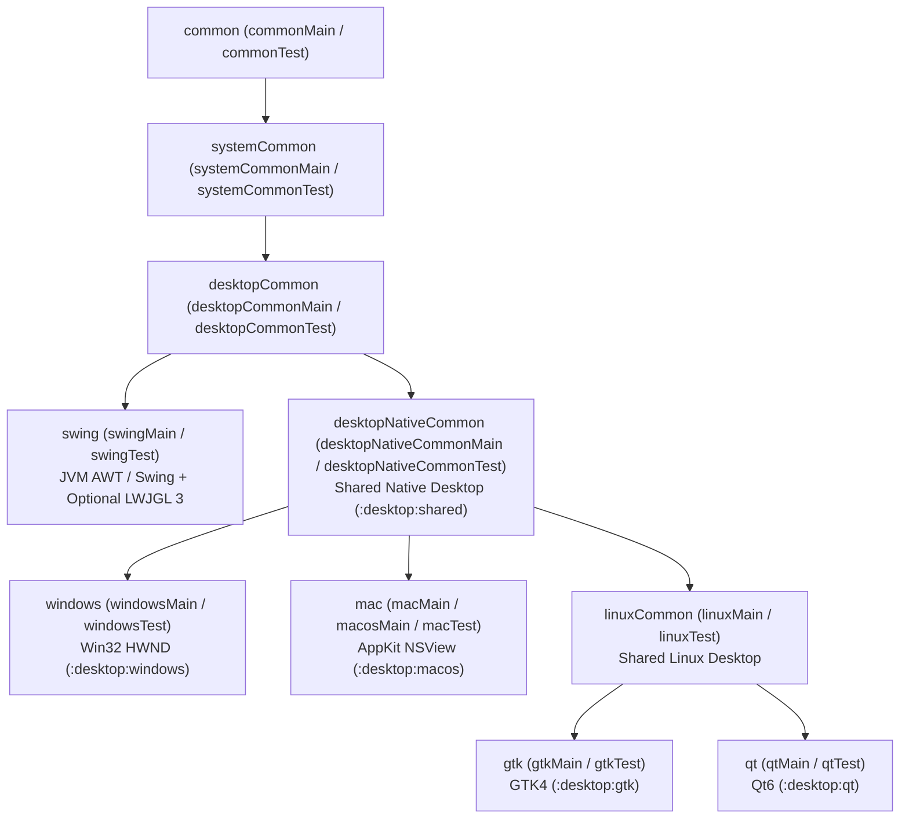

# GenericUI — Desktop Submodule (`:desktop`)

> **Root Repository**: [**GenericUI (`../README.md`)**](../README.md) | **Root Documentation**: [SourceSet Hierarchy](../docs/sourcesets.md) · [Backends Guide](../docs/backends.md) · [Extensions Guide](../docs/extensions.md) · [Gradle Plugin](../docs/gradle-plugin.md) · [UI Testing](../docs/testing.md)

The **Desktop Submodule (`:desktop`)** of **GenericUI** (`com.nexustools.genericui`) provides the shared native desktop runtime (`:desktop:shared`), four zero-overhead native OS desktop backends (`:desktop:windows`, `:desktop:macos`, `:desktop:gtk`, and `:desktop:qt`), and the optional Java/JVM desktop backend (`:desktop:swing`).

> [!IMPORTANT]
> **Zero VLC or Media Code in `:desktop`**
> The `:desktop` submodule and all of its child modules (`:desktop:shared`, `:desktop:windows`, `:desktop:macos`, `:desktop:gtk`, `:desktop:qt`, `:desktop:swing`) contain **NO** VLC (`libvlc` / `libvlcj`) or media playback code whatsoever. All video decoding, hardware acceleration (`D3D11VA`, `DXVA2`, `NVDEC`, `VAAPI`, `VDPAU`, `VideoToolbox`), Vulkan (`#version 450` SPIR-V) & OpenGL ES (`#version 300 es`) HDR tone-mapping (`HDR10 PQ`, `HLG`, `Dolby Vision`), high-precision playback clocks, and audio spectrum analysis live strictly inside the **`:extensions:media`** extension (`:extensions:media:desktop:shared`, `:extensions:media:desktop:{windows,macos,gtk,qt,swing}`). See [`:extensions:media` Documentation](../extensions/docs/media.md) for details.

---

## Submodule Architecture & Categorized Modules

| Gradle Module | Directory | Target Platforms | SourceSet Tier | Responsibility & Native Backing | Detailed Guide |
| :--- | :--- | :--- | :--- | :--- | :--- |
| **`:desktop:shared`** | [`shared/`](./shared) | `mingwX64`, `macosX64`, `macosArm64`, `linuxX64`, `linuxArm64` | `desktopNativeCommon` | Shared native desktop `NativeImpl` base classes (`DesktopBaseNativeImpl`, `DesktopBaseContainerNativeImpl`), GIMP Single-Window vs. Multi-Window dock coordination (`DesktopMultiWindowDockCoordinator`, `DesktopDockWorkspaceNativeImpl`), lazy viewport virtualization (`DesktopLazyViewportEngine`), and native file/folder dialog helpers (`DesktopFileBrowserHelper`). | [**`docs/shared.md`**](./docs/shared.md) |
| **`:desktop:windows`** | [`windows/`](./windows) | `mingwX64` | `windows` (`windowsMain` / `windowsTest`) | Native Win32 (`user32.dll`, `gdi32.dll`, `comdlg32.dll`, `dwmapi.dll`, `shell32.dll`) `HWND` widgets, `Win32NativeWindowHost`, `IFileOpenDialog` / `IFileSaveDialog` (`FOS_PICKFOLDERS`), WIC image codec (`WindowsWicImageCodecNativeImpl`), `.rc`/`.res` icon & version info embedding, Direct2D `Canvas2D`, Google ANGLE (`libEGL.dll` / `libGLESv2.dll`) `GLCanvas`, and Vulkan (`VK_KHR_win32_surface`) `VKCanvas`. | [**`docs/windows.md`**](./docs/windows.md) |
| **`:desktop:macos`** | [`macos/`](./macos) | `macosX64`, `macosArm64` | `mac` (`macMain` / `macosMain` / `macTest`) | Native macOS AppKit (`NSWindow`, `NSView`, `NSControl`), global top-of-screen macOS system menu bar (`NSApplication.sharedApplication.mainMenu`) populated from `TitleBar`, `NSOpenPanel` / `NSSavePanel`, ImageIO codec (`MacosImageIoCodecNativeImpl`), `Info.plist` & `.icns` bundle packaging, CoreGraphics `Canvas2D`, and `MoltenVK` (`VK_EXT_metal_surface`) `VKCanvas`. | [**`docs/macos.md`**](./docs/macos.md) |
| **`:desktop:gtk`** | [`gtk/`](./gtk) | `linuxX64`, `linuxArm64` | `linuxCommon` $\rightarrow$ `gtk` (`gtkMain` / `gtkTest`) | Native Linux GTK4 (`GtkWindow`, `GtkHeaderBar`, `GtkWidget`), `GtkFileDialog` + `GtkFileFilter`, `GdkPixbuf` codec (`GtkPixbufImageCodecNativeImpl`), Cairo `Canvas2D`, EGL/OpenGL ES 3.0+ `GLCanvas`, and Wayland/X11 Vulkan (`VK_KHR_wayland_surface` / `VK_KHR_xlib_surface`) `VKCanvas`. | [**`docs/gtk.md`**](./docs/gtk.md) |
| **`:desktop:qt`** | [`qt/`](./qt) | `linuxX64`, `linuxArm64` | `linuxCommon` $\rightarrow$ `qt` (`qtMain` / `qtTest`) | Native C++ Qt6 (`QMainWindow`, `QMenuBar`, `QDockWidget`, `QWidget`), `QFileDialog`, `QImage` codec (`QtQImageCodecNativeImpl`), `QPainter` `Canvas2D`, `QOpenGLWidget` `GLCanvas`, and `QVulkanWindow` `VKCanvas`. | [**`docs/qt.md`**](./docs/qt.md) |
| **`:desktop:swing`** | [`swing/`](./swing) | `jvm` | `desktopCommon` $\rightarrow$ `swing` (`swingMain` / `swingTest`) | Pure JVM AWT/Swing (`JFrame`, `JMenuBar`, `JComponent`, `JFileChooser`, `JScrollPane` lazy viewport recycling, `ImageIO` codec) with optional LWJGL 3 `JAWT` OpenGL ES (`useLwjglGL = true`) and Vulkan (`useVulkan = true`) hardware surfaces. | [**`docs/swing.md`**](./docs/swing.md) |

---

## Hierarchical SourceSet Integration

When you apply `id("com.nexustools.genericui")`, the GenericUI Gradle plugin automatically constructs a hierarchical Kotlin Multiplatform sourceSet tree so you can share desktop-specific code at the exact level of granularity needed without duplicating logic across OS targets.



| SourceSet Node | Main & Test Directories | Included Desktop Backends | Typical Use Cases |
| :--- | :--- | :--- | :--- |
| **`common`** | `src/commonMain`, `src/commonTest` | All 8 GenericUI Backends (`:desktop:*`, `:mobile:*`, `:web`) | Core UI trees, `Fragment`s, `DockWorkspaceFragment`, `AdaptiveSplitTabFragment`, `TitleBar`, and business logic. |
| **`systemCommon`** | `src/systemCommonMain`, `src/systemCommonTest` | `:desktop:*` + `:mobile:*` (excludes `:web`) | Direct filesystem I/O, POSIX/OS sockets, native process management, and hardware device discovery. |
| **`desktopCommon`** | `src/desktopCommonMain`, `src/desktopCommonTest` | `:windows`, `:macos`, `:gtk`, `:qt`, `:swing` | Multi-window docking workflows, desktop keyboard shortcuts, system tray menus, and desktop-specific window chrome. |
| **`swing`** | `src/swingMain`, `src/swingTest` | `:desktop:swing` | JVM reflection, Java libraries, AWT/Swing interop, and LWJGL 3 configuration. |
| **`desktopNativeCommon`** | `src/desktopNativeCommonMain`, `src/desktopNativeCommonTest` | `:windows`, `:macos`, `:gtk`, `:qt` (backed by `:desktop:shared`) | Kotlin/Native C-interop helpers, native pointer management, and `:desktop:shared` extensions. |
| **`windows`** | `src/windowsMain`, `src/windowsTest` | `:desktop:windows` | Win32 API calls, Windows Registry access, Direct2D/D3D11/ANGLE customization. |
| **`mac`** | `src/macMain` (or `src/macosMain`), `src/macTest` | `:desktop:macos` | Objective-C / AppKit integrations, macOS Dock badges, `NSMenu` customization, and Metal/MoltenVK hooks. |
| **`linuxCommon`** | `src/linuxMain` (or `src/linuxCommonMain`), `src/linuxTest` | `:desktop:gtk`, `:desktop:qt` | Shared Linux XDG desktop portals, DBus services, Wayland/X11 environment detection, and `alsa`/`pipewire` hooks. |
| **`gtk`** | `src/gtkMain`, `src/gtkTest` | `:desktop:gtk` | GTK4-specific `GtkWidget` CSS providers and `GObject` signals. |
| **`qt`** | `src/qtMain`, `src/qtTest` | `:desktop:qt` | Qt6-specific `QWidget` style sheets (`QSS`) and `QObject` slot connections. |

For the complete cross-platform hierarchy (including `:mobile` and `:web`), see [**Root SourceSet Hierarchy (`../docs/sourcesets.md`)**](../docs/sourcesets.md).

---

## Configuring Desktop Backends in `build.gradle.kts`

Use the `genericui { ... }` DSL from [`:gradle-plugin`](../docs/gradle-plugin.md) to enable any combination of desktop backends, configure native application icons, and register run/packaging tasks:

```kotlin
plugins {
    kotlin("multiplatform")
    id("com.nexustools.genericui")
}

genericui {
    backends {
        // Enable all 4 native C/C++/ObjC desktop backends (:windows, :macos, :gtk, :qt)
        allDesktopExceptSwing()

        // Or configure individual desktop backends explicitly:
        windows()
        macos()
        gtk()
        qt()

        // Optional JVM Swing backend with hardware-accelerated LWJGL 3 OpenGL ES & Vulkan
        swing {
            useLwjglGL = true
            useVulkan = true
            lwjglVersion = "3.3.6"
            targetAllDesktopClassifiers()
        }
    }

    application {
        mainClass = "com.example.studio.MainKt"
        appName = "Nexus Studio"
        appId = "com.example.studio"
        version = "1.0.0"

        // Platform-specific application icons:
        // - Windows embeds icon.ico into the .exe via .rc -> .res compilation
        // - macOS packages icon.icns into the .app/Contents/Resources bundle with Info.plist
        // - Linux (GTK/Qt) & Swing set the runtime window icon from icon.png
        icons(
            windows = "src/commonMain/resources/icons/icon.ico",
            mac = "src/commonMain/resources/icons/icon.icns",
            linux = "src/commonMain/resources/icons/icon.png",
            web = "src/commonMain/resources/icons/icon.svg",
            common = "src/commonMain/resources/icons/icon.png"
        )
    }

    graphics {
        bundleAngleOnWindows = true   // Google ANGLE (libEGL.dll, libGLESv2.dll) -> D3D11 for GLCanvas
        bundleMoltenVkOnApple = true  // Khronos MoltenVK (Vulkan 1.2 -> Metal) for VKCanvas on macOS
        bundleShaderc = true          // Runtime GLSL -> SPIR-V shader compiler
    }

    extensions {
        canvas2d() // Hardware-accelerated 2D canvas (Direct2D, CoreGraphics, Cairo, QPainter, Java2D)
        canvas3d() // Hardware-accelerated 3D canvases (GLCanvas & VKCanvas) -> transitively enables gpu()
        // If video/audio playback or VLC is needed, enable the :extensions:media module:
        // media()
    }
}
```

### Desktop Gradle Run & Packaging Tasks

| Backend | Development Run Task | Production Build / Package Task | Visual UI Test Task |
| :--- | :--- | :--- | :--- |
| **`:desktop:windows`** | `./gradlew windowsDevelopment` | `./gradlew windowsProduction` | `./gradlew windowsVisualTest` |
| **`:desktop:macos`** | `./gradlew macDevelopment` | `./gradlew macProduction` | `./gradlew macosTest` |
| **`:desktop:gtk`** | `./gradlew linuxDevelopmentGtk` | `./gradlew linuxProductionGtk` | `./gradlew gtkTest` |
| **`:desktop:qt`** | `./gradlew linuxDevelopmentQt` | `./gradlew linuxProductionQt` | `./gradlew qtTest` |
| **`:desktop:swing`** | `./gradlew swingDevelopment` | `./gradlew swingProduction` | `./gradlew swingTest` |

---

## Desktop Documentation Guides (`desktop/docs/*.md`)

1. [**Shared Native Desktop Runtime (`:desktop:shared`)**](./docs/shared.md) — `DesktopBaseNativeImpl`, `DesktopBaseContainerNativeImpl`, `DesktopLazyViewportEngine`, `DesktopFileBrowserHelper`, `DesktopMultiWindowDockCoordinator`, and `DesktopDockWorkspaceNativeImpl`.
2. [**Windows Win32 Backend (`:desktop:windows`)**](./docs/windows.md) — `WindowsNativeFactory`, `Win32NativeWindowHost`, Win32 `HWND` controls, Direct2D `Canvas2D`, Google ANGLE `GLCanvas`, Vulkan `VK_KHR_win32_surface` `VKCanvas`, `IFileOpenDialog`/`IFileSaveDialog` (`FOS_PICKFOLDERS`), and `.rc`/`.res` icon & version resource embedding.
3. [**macOS AppKit Backend (`:desktop:macos`)**](./docs/macos.md) — `MacosNativeFactory`, AppKit `NSWindow`/`NSView`, global macOS system menu bar integration via `TitleBar`, CoreGraphics `Canvas2D`, `MoltenVK` `VK_EXT_metal_surface`, `NSOpenPanel`/`NSSavePanel`, and `.app` bundle `Info.plist` & `.icns` packaging.
4. [**Linux GTK4 Backend (`:desktop:gtk`)**](./docs/gtk.md) — `GtkNativeFactory`, GTK4 widgets, `GtkHeaderBar`, Cairo `Canvas2D`, EGL/OpenGL ES `GLCanvas`, Wayland/X11 Vulkan `VKCanvas`, and `GtkFileDialog`.
5. [**Linux Qt6 Backend (`:desktop:qt`)**](./docs/qt.md) — `QtNativeFactory`, Qt6 widgets, `QMainWindow`/`QDockWidget`, `QPainter` `Canvas2D`, `QOpenGLWidget` `GLCanvas`, `QVulkanWindow` `VKCanvas`, and `QFileDialog`.
6. [**Java/JVM Swing Backend (`:desktop:swing`)**](./docs/swing.md) — `SwingNativeFactory`, AWT/Swing `JFrame`/`JComponent`, `Java2D` `Canvas2D`, `JFileChooser`, `JScrollPane` lazy viewport recycling, and optional LWJGL 3 OpenGL ES & Vulkan hardware rendering.

---

## Cross-References to Sibling Submodules & Root Docs

- **Root GenericUI Repository**: [`../README.md`](../README.md)
- **Root Architecture & Guides**:
  - [SourceSet Hierarchy (`../docs/sourcesets.md`)](../docs/sourcesets.md)
  - [Platform Backends Overview (`../docs/backends.md`)](../docs/backends.md)
  - [Extensions Architecture (`../docs/extensions.md`)](../docs/extensions.md)
  - [Gradle Plugin Reference (`../docs/gradle-plugin.md`)](../docs/gradle-plugin.md)
  - [UI Testing Guide (`../docs/testing.md`)](../docs/testing.md)
- **Sibling Submodules**:
  - **Media & VLC Extension (`:extensions:media`)**: [`../extensions/docs/media.md`](../extensions/docs/media.md) *(houses all `libvlc` / `libvlcj` video & audio code)*
  - **Mobile Backends (`:mobile`)**: [`../mobile/README.md`](../mobile/README.md) ([`:mobile:shared`](../mobile/docs/shared.md), [`:mobile:android`](../mobile/docs/android.md), [`:mobile:ios`](../mobile/docs/ios.md))
  - **Web Backend (`:web`)**: [`../web/README.md`](../web/README.md) ([Web Backend](../web/docs/web-backend.md), [Wasm/JS Loader & Splash](../web/docs/wasm-js-loader-and-splash.md))
  - **UI Testing Suite (`:tests` / `JestElectricRunner`)**: [`../tests/README.md`](../tests/README.md) ([`JestElectricRunner` Guide](../tests/docs/jest-electric-runner.md), [Platform Test Runners](../tests/docs/platform-test-runners.md))
  - **Nexus JavaScript Engine (`:NJS`)**: [`../NJS/README.md`](../lib/NJS/README.md) ([NJS Architecture](../lib/NJS/docs/architecture.md))
